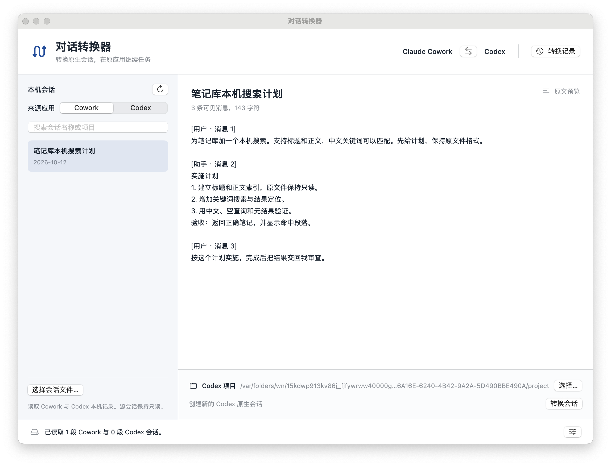

# 对话转换器 · Dialogue Converter

**把 Claude Cowork 与 Codex 的可见对话，转换成可以接续的原生会话。**

原生 macOS 应用。选择本机会话、核对原文、转换并导入；后续对话与模型调用继续留在 Claude 或 Codex 中。

[下载](https://github.com/Easesgr/dialogue-converter/releases) · [English](#english) · [构建](docs/BUILD.md) · [格式与兼容性](FORMAT_NOTES.md) · [隐私](docs/PRIVACY.md) · [MIT License](LICENSE)

## 支持范围

| 方向 | 转换与导入方式 | 状态 |
| --- | --- | --- |
| Claude Cowork → Codex 桌面端 | 读取 Cowork 本机任务记录，逐条转换，通过已安装 Codex 的原生历史导入接口创建会话 | 隔离导入、角色与全文读回、原生恢复检查通过；合成会话已在 Codex 桌面窗口显示 |
| Codex 桌面端 → Claude Cowork | 生成 Claude 原生历史 ZIP，在 Claude 的“设置 → 导入与导出”中导入 | 包格式与全文往返检查通过；本机用户确认合成会话导入成功并显示历史，模型接续待验证 |

**0.4.0 是原生会话转换的实验预览版。** Claude 的历史导入入口受版本、登录方式与组织配置影响。如果没有该入口，当前版本只能生成原生包，无法将它放入 Cowork 列表。请先确认自己的 Claude 有“导入与导出”设置。工具不会改变 Claude 的配置来开启隐藏功能。

Claude Chat / 网页对话、远程 Codex 会话、图片、音频、二进制附件、工具执行记录和私有推理不在本版转换范围内。

## 安装

需要 **macOS 14 或更新版本**，以及已安装的 Claude 与 Codex 桌面端。转换器内置 Python 运行环境，用户无需安装 Python、Homebrew 或 Xcode。

在 [Releases](https://github.com/Easesgr/dialogue-converter/releases) 下载与你的 Mac 对应的安装包：

- Apple Silicon（M 系列）：DialogueConverter-0.4.0-macos-arm64.dmg
- Intel：DialogueConverter-0.4.0-macos-x86_64.dmg

打开 DMG，将 **对话转换器.app** 拖到 **Applications**。Release 还提供 ZIP 与 SHA256 校验文件。

公开包使用临时签名，**未经 Apple 公证**。首次打开被阻止时，在尝试启动后到 **系统设置 → 隐私与安全性 → 仍要打开**，核对名称后确认。无需关闭系统安全保护。受管理的 Mac 可能需要管理员批准。

## 使用

### Cowork 的计划交给 Codex

1. 在左侧选 **Cowork**，选择已保存到本机的任务。
2. 核对右侧的用户要求和计划。预览可省略长文本的中间部分，转换保留全部可见文字。
3. 选择 Codex 要继续工作的本机项目文件夹。
4. 点击 **转换会话**，再点击 **导入 Codex**。
5. 显示“已导入”后，点击 **在 Codex 继续**，在原应用输入接下来的要求。

转换器为目标创建独立会话，不覆盖已有会话。Cowork 的内部工作目录无法直接作为 Codex 的本机项目目录，需要明确选择文件夹。

### Codex 的结果交回 Cowork

1. 在转换记录中选择上次已导入的任务，点击 **选择目标会话交回**；也可以直接在左侧选 Codex 会话。
2. 点击 **转换会话**，得到 Cowork-conversation.zip。
3. 点击 **显示文件**，在 Claude 的 **设置 → 导入与导出** 中选择这个 ZIP，按 Claude 的原生向导完成导入。
4. 回到转换器，点击 **检查导入结果**。工具会在 Cowork 本机记录中匹配引擎会话编号，并逐条核对可见原文。
5. 检测成功后在 Claude 打开对应任务。Claude 对导入历史的继续确认与文件授权仍由原应用处理。

本机用户已确认合成 ZIP 导入成功并能看到历史。转换器在当前资料目录尚未自动匹配到该测试记录，模型接续也未验证。若 Claude 已显示历史、转换器仍未检测到，请在“应用连接”中选择该 Claude 实例的资料目录后重试。

## 实用功能

- **原生消息转换**：保留用户 / 助手角色、顺序、完整可见文字与中文，不生成摘要。
- **压缩前历史恢复**：Cowork 消息链跨越压缩边界时，按逻辑父消息接回早期可见记录，并排除被放弃的重试分支。
- **重复转换检测**：相同来源、内容、去向与项目复用转换记录，避免重复创建目标；内容变化后生成新的独立快照。
- **导入结果核对**：Codex 导入后立即读回角色与全文；Cowork 导入后可以扫描验证。
- **中断恢复核对**：Codex 返回目标编号后立即保存。如果随后读回中断，可重新检查已有目标，避免重复创建会话。
- **来回转换**：记录来源、目标编号与本机路径，已导入的目标可以直接作为下一次来源。每次是完整历史快照。
- **本机转换记录**：重新打开已生成的原生包，继续导入、导出或选择目标会话交回。
- **目录与应用选择**：自动发现 Claude / Claude-3p 的 Cowork 任务与 Codex 本机历史，可指定其他资料目录和 .app。
- **原生快捷键**：⌘Return 转换、⌘O 选择会话文件、⌘R 刷新、⌘⇧X 交换方向、⌘⇧H 转换记录。

## 隐私与性能

转换器不调用模型，不向远程服务发送会话内容。Codex 导入使用本机已安装程序，Claude 导入由 Claude 自己完成。原程序可能有自己的网络与遥测行为。

转换资料保存在：

~~~text
~/Library/Application Support/DialogueConverter/conversions/
~~~

目录权限为 0700，文件为 0600。不复制 API Key、原应用系统提示、模型设置、文件授权或执行权限。**消息正文中的敏感文字会按原文保留**，导出包也包含完整可见对话，请自行保管。详见 [PRIVACY.md](docs/PRIVACY.md)。

转换器按操作运行，没有后台循环或额外摘要模型开销。导入的历史会占用接收模型的上下文和用量，不能保证长会话的速度、缓存命中或推理效果相同。文件与输出产物不会随历史复制；需要接续的项目文件应位于目标应用可访问的目录。

## 开发与验证

~~~bash
python3 -m unittest discover -s tests -v
xcrun swiftc -swift-version 5 -parse-as-library -typecheck Models.swift main.swift
python3 scripts/check_native_import.py  # 需要安装支持原生导入的 Codex 桌面端
python3 packaging/bootstrap_python.py
python3 build_app.py --package
~~~

原生接口检查使用隔离的 HOME / CODEX_HOME 与合成文本，不读取真实用户资料，不发送 turn/start。详见 [BUILD.md](docs/BUILD.md)。

0.3.0 是早期交接文字原型；0.4.0 已将应用主流程改为原生会话转换。旧资料仍留在本机，旧版交接动作没有出现在新版界面中。

## English

Dialogue Converter is a native macOS utility for **Claude Cowork ↔ Codex desktop native conversation conversion**. Model execution stays in the original applications.

- **Cowork → Codex:** read local Cowork engine history, preserve visible user/assistant messages, and use the installed Codex app's native session importer. Isolated tests verify exact text/roles, repeat import protection, and native thread resume without model generation. A synthetic imported session was also visibly rendered in the Codex desktop app.
- **Codex → Cowork:** create a Claude desktop history ZIP. Import it through Claude's own **Settings → Import & Export** flow, then verify the imported local history. A local user confirmed successful synthetic ZIP import with visible history. Automatic lookup in the current profile did not find that test record; resumed model generation remains unverified.
- This is a **0.4.0 experimental preview**. Claude import availability depends on its version and account/provider configuration. The converter does not enable hidden features or write directly into a running Claude profile.
- Local conversion receipts, full-history snapshots, duplicate detection, custom data directories, native app activation, and export are included.
- macOS 14+; Apple Silicon and Intel packages contain the runtime. Public builds are ad hoc signed and **not notarized**.
- No model calls, source-history modifications, credential copying, or private reasoning transfer. Visible text may itself contain secrets; review and protect exported archives.
- Imported history consumes destination context. Tool state, attachments, file access grants, model caches, and identical model performance cannot be migrated.

MIT licensed. Bundled runtime components retain their own licenses.
